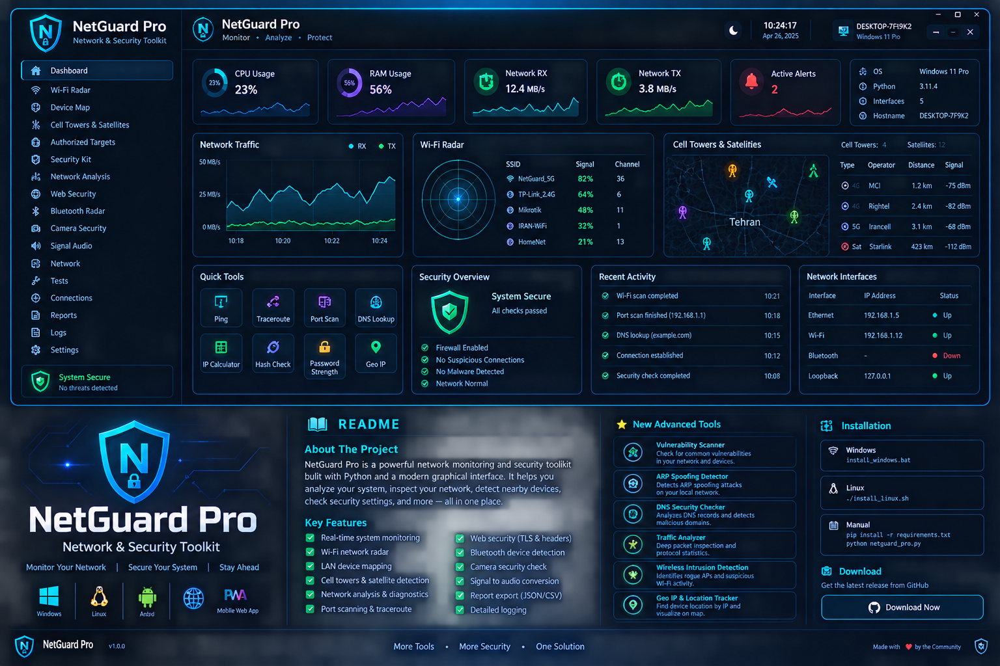

# NetGuard Pro



> A modern, defensive network and system observability toolkit for Windows and Linux.

NetGuard Pro combines host telemetry, Wi-Fi visibility, local LAN mapping, authorized connectivity checks, web/TLS diagnostics, Bluetooth and camera inventory, network analysis, public radio-mast mapping, and public orbital-data visualization in one dark cyber-style desktop application.

## Highlights

- Real-time CPU, memory, RX/TX traffic and interface monitoring
- Wi-Fi radar with SSID, signal, channel and authentication details
- Local ARP-cache device map without active LAN probing
- Authorized target allowlist for explicit TCP connectivity tests
- Firewall, DNS, adapter, public-IP and baseline checks
- Windows Bluetooth and local camera inventory
- Web TLS and security-header inspection
- Network Analysis: DNS resolution, traceroute, TLS inspection and subnet calculator
- Cell Tower / Radio Mast map using public OpenStreetMap/Overpass data
- Satellite awareness using public CelesTrak orbital elements and optional Skyfield calculations
- Signal-to-audio visualization for Wi-Fi signal trends
- Active connection inventory and JSON/CSV reports
- Structured local logging
- Windows, Linux and mobile-PWA project components

## Radio & Satellite Awareness

The Nearby Towers & Satellites module is intentionally transparent about what it does. Cellular infrastructure is mapped from public OpenStreetMap data; satellites are not detected through radio hardware. Instead, public orbital elements are downloaded from CelesTrak and Skyfield can calculate the current apparent altitude, azimuth and distance from a user-supplied observer location.

This means the feature is an **awareness and visualization tool**, not a spectrum analyzer or RF detector.

## Network Safety Model

NetGuard Pro is designed for defensive diagnostics. Network tests are intended for systems and networks you own or are explicitly authorized to assess. The application does not include credential theft, password cracking, exploit automation, persistence, or stealth features.

## One-click installers

- **Windows:** double-click `NetGuardPro_Install.bat`. It installs dependencies, creates a Desktop shortcut, and launches NetGuard Pro.
- **Linux:** run `NetGuardPro_Install.sh`. It installs dependencies, adds a desktop application entry, and launches NetGuard Pro.
- **Mobile:** open the PWA and press **INSTALL APP** (or use your browser menu → Install app / Add to Home Screen).

> Windows/Linux desktop builds still require Python because the project ships as a source-based desktop app. A fully self-contained `.exe`/native binary must be built separately on its target operating system; PyInstaller is designed to bundle Python apps, but it is not a cross-compiler. citeturn0search0turn0search4

## Installation

### Windows

```powershell
py -m pip install -r requirements.txt
py netguard_pro.py
```

Or use `install_windows.bat`.

### Linux

```bash
python3 -m pip install -r requirements.txt
python3 netguard_pro.py
```

Or use `install_linux.sh`.

### Satellite calculations

Skyfield is included in `requirements.txt`. If you only need the rest of the toolkit, the core application can still run without the satellite calculation package; the Satellite module will report that the dependency is missing.

## Data Sources

- Local operating-system APIs and command-line diagnostics
- OpenStreetMap / Overpass for public mast objects
- CelesTrak for public orbital element sets
- Public IP and DNS services where explicitly requested by the user

External services can change availability, rate limits or response formats. No API key is embedded in the source tree.

## Project Layout

```text
NetGuard Pro/
├── netguard_pro.py
├── requirements.txt
├── install_windows.bat
├── install_linux.sh
├── README.md
├── assets/
│   ├── netguard_pro_icon.png
│   ├── netguard_pro_icon.ico
│   ├── netguard_pro_logo.png
│   └── netguard_pro_logo.svg
├── web/
│   └── index.html
├── mobile/
│   ├── index.html
│   ├── manifest.json
│   └── sw.js
└── downloads/
```

## Design

The interface uses a dark glass/cyber aesthetic with cyan, green and violet accents, compact data cards, high-contrast tables, a scrollable left navigation rail and a scrollable content area. The branded PNG logo and ICO application icon are included in the assets folder.

## License

Add the license that matches your intended distribution model before publishing the repository.

## UI navigation and radio/space view

The desktop interface now includes a vertical scrollbar for the main workspace so the full dashboard and tool panels remain reachable on smaller screens. The Nearby Towers & Satellites page also includes a relative awareness map, scrollable tower and satellite tables, and automatic public-data scans when the page is opened.

The Windows installer creates a Desktop shortcut using `assets/netguard_pro_icon.ico`.
